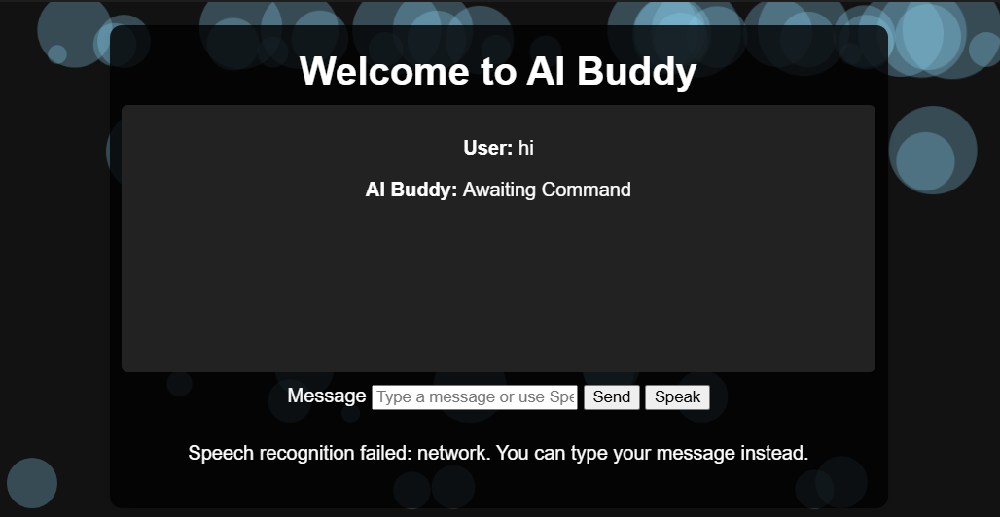

# Tenali Raman AI Buddy

A browser-based personal assistant built with Django and Python. Chat by typing or, in supported browsers, use speech recognition to send a message.



## Credits

The frontend was created and handled by Ritik.

## What it can do

- Accept typed messages and browser-recognized speech.
- Answer time and date questions, tell jokes, and look up information on Wikipedia.
- Search Google or open YouTube, and play a requested song on YouTube.
- Get weather information when an OpenWeather API key is configured.
- Send email through Gmail SMTP when email credentials are configured.
- Request a system shutdown or restart with an explicit confirmation.

Browser speech recognition depends on browser support and microphone permission. Typing remains available when speech recognition is unavailable.

## Run locally

### Requirements

- Python 3.10 or later
- Pip
- A browser for the chat interface

### Setup

Clone the repository and create a virtual environment from the repository root:

```bash
git clone https://github.com/TharunRacharla/Tenali.git
cd Tenali
python -m venv .venv
```

Activate the virtual environment:

```powershell
# Windows PowerShell
.\.venv\Scripts\Activate.ps1
```

```bash
# macOS / Linux
source .venv/bin/activate
```

Install the project dependencies:

```bash
pip install -r requirements.txt
```

Copy `.env.sample` to `.env` in the repository root, then fill in the values you need. The Django secret key is required; weather and email settings are optional unless you want to use those features.

```dotenv
SECRET_KEY=replace-with-a-long-random-secret
DEBUG=True
ALLOWED_HOSTS=127.0.0.1,localhost

# Optional: weather lookups
OPENWEATHER_API_KEY=your_openweather_api_key

# Optional: Gmail SMTP email
EMAIL_USER=your_email@gmail.com
EMAIL_PASS=your_gmail_app_password
EMAIL_FROM=your_email@gmail.com
```

For Gmail, use an app password where required; do not put real credentials in source control.

Run the app from its Django project directory:

```bash
cd ai_buddy_website
python manage.py migrate
python manage.py runserver
```

Open [http://127.0.0.1:8000](http://127.0.0.1:8000).

## Try it

Type a message, or select **Speak** and allow microphone access if your browser supports speech recognition.

Example requests:

```text
What time is it?
Tell me a joke
What is the weather in Paris?
Open Google Django documentation
Play songs on YouTube lo-fi music
Send email to recipient@example.com saying Hello from AI Buddy
```

Weather and email requests need their corresponding optional credentials in `.env`. Shutdown and restart requests require clicking **Confirm**; the confirmation expires after one minute and can be canceled.

> **Important:** Shutdown and restart commands are executed on the computer running the Django server, not on the visitor's device. Run this project locally and do not expose it to untrusted users or the public internet with these actions enabled.

## Run tests

From `ai_buddy_website`, run:

```bash
python manage.py test tenali
python manage.py check
python manage.py makemigrations --check --dry-run
```

## Contributing

Issues and pull requests are welcome. For a change, create a branch, make and test your update, and open a pull request with a concise description of the change.
